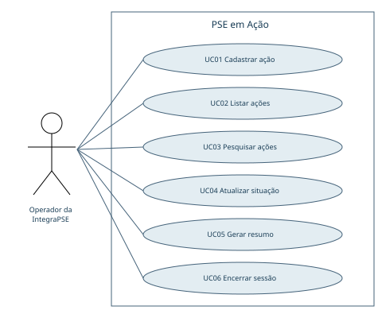
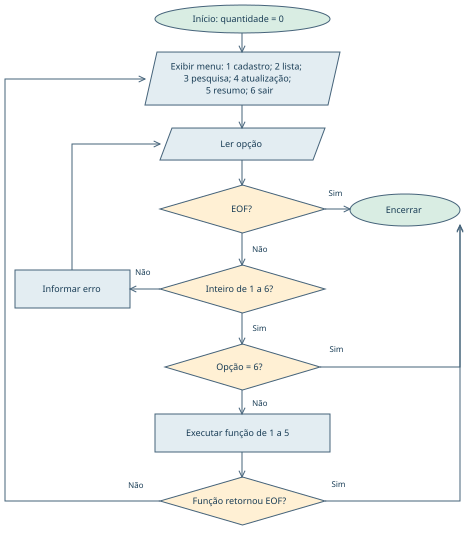
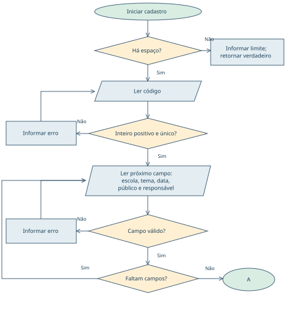
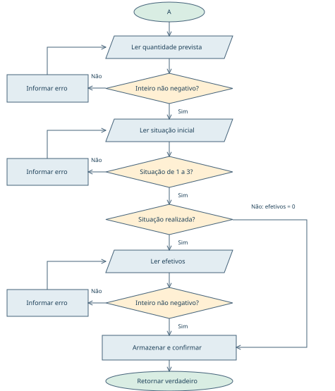
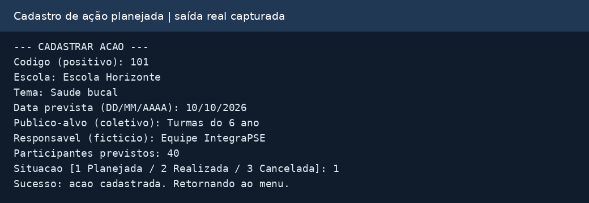
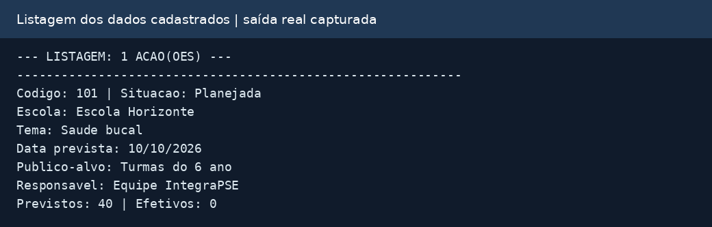
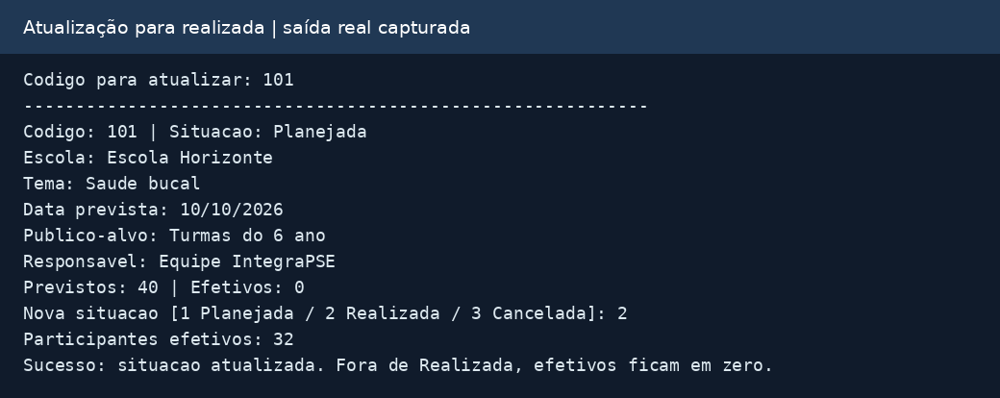

# PSE EM AÇÃO

UNIVERSIDADE CESUMAR - UNICESUMAR

Engenharia de Software • ESOFT2S-NA

Atividade de Estudo Programada • 2026/2

Sistema de Planejamento e Acompanhamento de Ações de Saúde na Escola

2ª entrega: implementação e apresentação

| Integrante | R.A. |
| --- | --- |
| Daniel Muniz Gallina | 26008793-2 |
| Murilo Bovo Bonvechio | 26011546-2 |
| Victor Hugo Maran Kalomenconkovas | 26001189-2 |

Revisão 2 - 13 de outubro de 2026. Relatório técnico da implementação. Código e testes executados em ambiente Linux com GCC. A validação no ambiente do professor, a publicação no GitHub e a gravação do vídeo permanecem pendentes.

Repositório informado na primeira entrega: https://github.com/VictorHugoMaran/AEP-1-Bimestre-ESOFT2S-NA

Escopo desta revisão: implementação e documentação. A apresentação em vídeo não foi revisada.

# Sumário

| Seção | Página no PDF |
|---|---|
| 1. Continuidade da primeira entrega | 3 |
| 2. Requisitos implementados | 4 |
| 3. Decisões e refinamentos do escopo | 5 |
| 4. Estrutura e rastreabilidade | 6 |
| 5. Diagrama de casos de uso | 7 |
| 6. Casos de uso: cadastro e listagem | 8 |
| 7. Casos de uso: pesquisa e atualização | 9 |
| 8. Casos de uso: resumo e saída | 10 |
| 9. Fluxograma geral revisado | 11 |
| 10.1 Cadastro: identificação e campos | 12 |
| 10.2 Cadastro: quantidades e situação | 13 |
| 11. Pseudocódigos revisados | 14 |
| 12. Manual: compilar e executar | 15 |
| 13. Manual: opções e exemplo completo | 16 |
| 14. Testes: operações principais | 17 |
| 15. Testes: validação e limites | 18 |
| 16. Evidências de execução: limites | 19 |
| 17. Evidências: atualização e resumo | 20 |
| 18. Resultados e considerações finais | 21 |
| 19. Revisões e pendências de validação | 22 |

# 1. Continuidade da primeira entrega

Esta versão transforma o planejamento apresentado por Gallina, Bonvechio e Kalomenconkovas (2026) em uma aplicação funcional de terminal em linguagem C. O escopo segue o enunciado da AEP e os requisitos RF01 a RF06 e RNF01 a RNF04 definidos pela equipe.

O problema considerado é a dispersão das informações das ações coletivas do PSE em anotações, formulários e planilhas. A equipe fictícia IntegraPSE precisa consultar o que foi planejado, acompanhar situações e consolidar as participações registradas.

Os usuários diretos são coordenadores do programa, profissionais da Atenção Primária à Saúde e representantes das equipes pedagógicas. Os estudantes são beneficiários indiretos e não possuem cadastro individual no sistema.

O objetivo geral desta etapa é implementar e verificar uma aplicação em C que centralize o cadastro, a consulta, a pesquisa, a atualização e o resumo das ações coletivas, mantendo a finalidade organizacional estabelecida no planejamento.

Os objetivos específicos são implementar as operações previstas; validar dados e limites; relacionar requisitos, algoritmos e funções; registrar testes reproduzíveis; e fornecer manual e material de apoio à apresentação final.

A demonstração usa saúde bucal, atividade física e alimentação saudável. O campo tema é livre, permitindo outras temáticas. Todos os exemplos são fictícios e coletivos, sem dados clínicos ou identificação de estudantes.

## Organização dos entregáveis

| Conteúdo | Local no pacote |
| --- | --- |
| Código-fonte em C | src/main.c |
| Documento final e fonte editável | docs/AEP_2_Entrega_PSE_em_Acao.pdf e .md |
| Modelagem revisada | docs/casos_de_uso.svg e fluxograma_*.svg |
| Testes e evidências | tests/testar.py e docs/evidencias/ |
| Instruções e vídeo | README.md e docs/roteiro_video.md |
| Primeira entrega preservada | docs/AEP_1_Entrega_PSE_em_Acao.pdf |

# 2. Requisitos implementados

| ID | Comportamento verificável | Funções principais |
| --- | --- | --- |
| RF01 | Cadastrar código, escola, tema, data, público, responsável, previsão e situação; solicitar efetivos se já realizada. | cadastrarAcao; armazenarAcao |
| RF02 | Listar todos os registros e seus campos; informar quando a base estiver vazia. | listarAcoes; exibirAcao |
| RF03 | Pesquisar por código exato ou trecho de escola/tema; exibir todas as correspondências. | pesquisarAcoes; buscarCodigo; contemTexto |
| RF04 | Atualizar situação e efetivos quando realizada; zerar efetivos nas outras situações. | atualizarSituacao |
| RF05 | Contar situações; somar efetivos e previsões. Percentual = 100 × efetivos das realizadas / previstos das realizadas; denominador zero resulta em N/A. | gerarResumo |
| RF06 | Rejeitar duplicidade, valores inválidos, campos vazios, datas inexistentes e excesso de capacidade. | lerLinha; lerTexto; lerInteiro; dataValida |

| ID | Requisito não funcional e evidência |
| --- | --- |
| RNF01 | Terminal sem interface gráfica; programa usa apenas a biblioteca padrão de C. |
| RNF02 | Dados mantidos em vetor na memória; nova execução começa vazia. |
| RNF03 | Operações separadas em funções; main coordena o menu. |
| RNF04 | Mensagens de confirmação, erros e orientação de preenchimento. |

Os seis requisitos funcionais foram preservados. A validação (RF06) ocorre dentro das operações; não constitui uma sétima opção. O menu continua com opções de 1 a 5 para operações e 6 para encerrar, conforme a primeira entrega.

# 3. Decisões e refinamentos do escopo

| Regra | Definição e justificativa |
| --- | --- |
| Capacidade e códigos | Máximo de 100 ações por execução. Código inteiro positivo e único; limite técnico INT_MAX da implementação C. Não existe exclusão. |
| Textos e data | Campos textuais até 100 bytes, sem espaços vazios nas extremidades. Datas reais no formato DD/MM/AAAA, anos de 0001 a 9999; não se compara a data com o dia atual. |
| Situação inicial | 1 Planejada, 2 Realizada ou 3 Cancelada. Cadastro já realizado exige efetivos, completando o algoritmo da primeira etapa. |
| Atualização | Qualquer situação pode ser substituída pelas três opções. Realizada solicita efetivos novamente; outras situações zeram esse valor. Não existe histórico das mudanças. |
| Quantidades | Inteiros de zero até INT_MAX. Efetivos podem superar a previsão; percentual superior a 100% é permitido. |
| Pesquisa textual | Busca parcial. Ignora maiúsculas/minúsculas nas letras ASCII; acentos precisam coincidir. Não há normalização Unicode. |
| Interrupção | EOF encerra a execução e não confirma a operação incompleta. É tratamento técnico de entrada encerrada, além da saída normal pela opção 6. |

## Fórmula do resumo

Percentual de participação = 100 × soma dos efetivos das ações realizadas ÷ soma dos previstos dessas mesmas ações. Planejadas e canceladas não entram no denominador, evitando misturar atividades ainda não executadas com resultados de atividades concluídas.

Quando a previsão das realizadas é zero, o resultado é N/A, inclusive se houver efetivos. O total previsto de todas as ações é mostrado separadamente. Os totais representam participações acumuladas, não estudantes únicos. Essa interpretação detalha uma regra aberta na primeira entrega; não constitui fórmula expressamente imposta pelo enunciado.

# 4. Estrutura e rastreabilidade

## Representação em memória

```text
typedef struct {
    int codigo;
    char escola[101], tema[101], data[11];
    char publico[101], responsavel[101];
    int prevista, situacao, efetiva;
} Acao;

Acao acoes[100];
int quantidade = 0;
```

O vetor armazena as ações; quantidade indica quantas posições estão ocupadas. O código usa condicionais, switch, for, do/while e funções. Os acumuladores do resumo são long long para comportar a soma de várias quantidades grandes.

A leitura usa fgets e strtol para rejeitar texto em campos numéricos, decimais, caracteres extras e números fora do intervalo. O cadastro monta uma variável local e só a armazena depois da validação completa. A atualização também confirma situação e efetivos juntos.

| Planejamento / requisito | Implementação e verificação |
| --- | --- |
| Menu e pseudocódigo geral | main + exibirMenu; repetição até opção 6; T01 e T15. |
| Fluxograma de cadastro / RF01 e RF06 | cadastrarAcao + validadores; T02 a T05, T16 a T20, T22 a T24 e T27. |
| Consulta / RF02 e RF03 | listarAcoes + pesquisarAcoes; T01, T02, T06 a T08 e T25. |
| Acompanhamento / RF04 | atualizarSituacao; T09 a T11, T28 e T30. |
| Resumo / RF05 | gerarResumo; T03, T12 a T14, T21 e T29. |
| Memória / RNF02 | Vetor local na main; T26. |

## Processo incremental

O planejamento original de seis sprints foi preservado: levantamento; modelagem; documentação; implementação básica; operações complementares e testes; documentação final e apresentação. Este pacote materializa os artefatos das etapas de implementação e documentação, mas não comprova datas, reuniões ou participação individual nas sprints. A cronologia de execução e a participação dos integrantes não foram avaliadas nesta revisão.

# 5. Diagrama de casos de uso



Diagrama de casos de uso — operações disponíveis ao operador. Fonte: elaboração com base nos requisitos da primeira entrega.

O ator Operador da IntegraPSE representa os coordenadores, profissionais de saúde e representantes pedagógicos que utilizam as mesmas funções. Não há autenticação nem perfis de permissão distintos nesta versão.

Registrar participantes efetivos faz parte dos fluxos condicionais de cadastro e atualização de uma ação realizada. RF06 é uma regra transversal de validação, e não um objetivo independente do ator. UC06 representa o encerramento, uma interação auxiliar de sessão descrita nas páginas seguintes.

Não há associação de estudantes ao sistema, porque não utilizam a aplicação diretamente e não são cadastrados individualmente.

# 6. Casos de uso: cadastro e listagem

## UC01 - Cadastrar ação (RF01, RF06)

Objetivo: registrar uma ação coletiva completa. Ator: Operador da IntegraPSE. Pré-condição: programa em execução. A disponibilidade de espaço é verificada no início da operação.

Fluxo principal: 1) selecionar opção 1 e verificar a capacidade; 2) informar código positivo não utilizado; 3) preencher escola, tema, data válida, público e responsável; 4) informar quantidade prevista; 5) escolher situação inicial; 6) se realizada, informar efetivos; 7) o sistema armazena a ação, confirma e retorna ao menu.

Fluxos alternativos: código duplicado solicita outro código; entrada inválida ou vazia repete o campo; data inexistente solicita correção; se o vetor estiver cheio, o cadastro não começa e o sistema retorna ao menu; EOF encerra sem salvar cadastro parcial.

Pós-condições: uma ação completa é incluída e quantidade aumenta em um. Planejadas e canceladas possuem efetivos iguais a zero. Se o cadastro não for concluído, não existe novo registro.

## UC02 - Listar ações (RF02)

Objetivo: visualizar todas as ações cadastradas. Ator: Operador da IntegraPSE. Pré-condição: programa em execução.

Fluxo principal: 1) selecionar opção 2; 2) o sistema percorre as posições ocupadas do vetor; 3) exibe código, situação, escola, tema, data, público, responsável, previstos e efetivos; 4) retorna ao menu.

Fluxo alternativo: com vetor vazio, o sistema informa que nenhuma ação está cadastrada e retorna ao menu.

Pós-condição: os registros são apresentados sem alteração dos dados.

# 7. Casos de uso: pesquisa e atualização

## UC03 - Pesquisar ações (RF03, RF06)

Objetivo: localizar registros por código, escola ou tema. Ator: Operador da IntegraPSE. Pré-condição: programa em execução.

Fluxo principal: 1) selecionar opção 3; 2) escolher código, escola ou tema; 3) informar código exato ou trecho textual; 4) o sistema exibe todas as correspondências e a quantidade encontrada; 5) retorna ao menu.

Fluxos alternativos: base vazia informa ausência de cadastros; código ou texto sem correspondência informa que nenhuma ação foi encontrada; critério inválido ou texto vazio solicita correção; EOF encerra a aplicação.

Pós-condição: resultados são exibidos; os dados não são modificados.

## UC04 - Atualizar situação (RF04, RF06)

Objetivo: registrar o andamento da ação e o comparecimento coletivo. Ator: Operador da IntegraPSE. Pré-condição: programa em execução; para concluir a atualização, deve existir ação com o código informado.

Fluxo principal: 1) selecionar opção 4; 2) informar o código; 3) conferir o registro exibido; 4) selecionar a nova situação; 5) se realizada, informar participantes efetivos; 6) o sistema confirma os novos valores e retorna ao menu.

Fluxos alternativos: base vazia ou código inexistente gera mensagem e retorna ao menu; situação inválida ou efetivos negativos/não inteiros solicita correção; se a nova situação for planejada ou cancelada, efetivos passam a zero; selecionar realizada novamente permite corrigir os efetivos; EOF antes da confirmação não aplica a alteração e encerra o sistema.

Pós-condição: a situação e os efetivos ficam consistentes com a escolha. Os demais campos permanecem iguais. Não há histórico ou função de desfazer.

# 8. Casos de uso: resumo e saída

## UC05 - Gerar resumo (RF05)

Objetivo: visualizar quantidades de ações e resultados agregados. Ator: Operador da IntegraPSE. Pré-condição: programa em execução.

Fluxo principal: 1) selecionar opção 5; 2) o sistema percorre o vetor; 3) conta planejadas, realizadas e canceladas; 4) soma a previsão geral, a previsão das realizadas e os efetivos das realizadas; 5) calcula o percentual; 6) apresenta os resultados e retorna ao menu.

Fluxos alternativos: sem cadastros, os totais são zero; sem previsão nas realizadas, o percentual é N/A. Resultados superiores a 100% são exibidos normalmente, pois os efetivos podem superar a previsão.

Pós-condição: o usuário visualiza um resumo referente ao estado atual da memória; nenhum registro é alterado.

## UC06 - Encerrar sessão (interação auxiliar)

Objetivo: finalizar a execução. Ator: Operador da IntegraPSE. Pré-condição: programa em execução.

Fluxo principal: 1) selecionar opção 6; 2) o sistema informa o encerramento e o descarte dos dados em memória; 3) termina a execução.

Fluxo alternativo técnico: se a entrada chegar ao fim (EOF), o programa encerra com mensagem específica, sem insistir em ler indefinidamente. Fechar o terminal também implica perda da memória.

Pós-condição: programa encerrado; uma próxima execução inicia com vetor vazio. Não é criado arquivo com os cadastros.

## Exemplo verificável de cálculo

Uma ação realizada prevê 40 participações e recebe 32. Outra ação planejada prevê 20 e uma cancelada prevê 10. O resumo mostra 70 previstos em todas as ações, 40 previstos nas realizadas e 32 efetivos. O percentual é 32 ÷ 40 × 100 = 80%.

# 9. Fluxograma geral revisado



Figura 1 - Fluxo geral. Fonte: elaboração para esta revisão a partir do planejamento da primeira entrega. A opção inválida repete a leitura; após uma operação concluída, o menu é exibido novamente. EOF na leitura ou dentro de uma operação encerra a execução.

# 10.1 Cadastro: identificação e campos



Figura 2 - Cadastro, parte A. Fonte: revisão do fluxograma original. Campos válidos são não vazios, dentro do tamanho permitido; a data também deve existir no calendário. Cada campo inválido é solicitado novamente, preservando os anteriores.

Regra comum às Figuras 2 e 3: se qualquer leitura atingir EOF, o cadastro é abandonado e retorna falso à main, sem inserir registro. O conector A continua na Figura 3. O fim por capacidade esgotada retorna verdadeiro e mantém a sessão aberta.

# 10.2 Cadastro: quantidades e situação



Figura 3 - Cadastro, parte B. Fonte: revisão do fluxograma original. Mantém a sequência previsão, situação e armazenamento. O ramo realizada acrescenta a leitura de efetivos. O registro local inicia zerado e só é inserido após todas as validações.

# 11. Pseudocódigos revisados

## Menu principal

```text
INICIO
  quantidade <- 0
  entradaAberta <- VERDADEIRO
  REPITA
    EXIBIR menu (1 cadastro, 2 lista, 3 pesquisa,
                 4 atualizacao, 5 resumo, 6 sair)
    LER opcao inteira entre 1 e 6, repetindo se invalida
    SE EOF: entradaAberta <- FALSO; INTERROMPER
    ESCOLHA opcao
      1: entradaAberta <- CadastrarAcao()
      2: ListarAcoes()
      3: entradaAberta <- PesquisarAcoes()
      4: entradaAberta <- AtualizarSituacao()
      5: GerarResumo()
      6: EXIBIR encerramento
    FIM ESCOLHA
  ATE opcao = 6 OU entradaAberta = FALSO
FIM
```

## Cadastro de ação

```text
INICIO CADASTRO
  SE quantidade >= 100: INFORMAR limite; RETORNAR VERDADEIRO
  nova <- registro com valores zerados
  REPETIR leitura do codigo positivo ATE codigo nao existir
  LER escola e tema obrigatorios
  REPETIR leitura da data ATE data existir no calendario
  LER publico e responsavel obrigatorios
  LER prevista inteira >= 0
  LER situacao inteira de 1 a 3
  SE situacao = REALIZADA
    LER efetiva inteira >= 0
  FIM SE
  ArmazenarAcao(vetor, quantidade, nova)
  EXIBIR confirmacao
  RETORNAR VERDADEIRO
FIM CADASTRO
```

Em toda leitura: REPETIR a solicitação ENQUANTO a entrada for inválida. Texto vazio, excesso de tamanho e números inválidos são recusados. SE ocorrer EOF, RETORNAR FALSO imediatamente, antes de confirmar a operação. As demais operações com leitura seguem o mesmo contrato de retorno. ArmazenarAcao copia o registro para o vetor e incrementa a quantidade.

# 12. Manual: compilar e executar

## Objetivo e ambiente principal: Dev-C++

O sistema organiza ações coletivas do PSE em uma sessão de terminal. O ambiente informado pela equipe é Dev-C++ no Windows. A execução desta revisão foi verificada em Linux/GCC; a comprovação no Dev-C++ permanece pendente.

1) Extraia o pacote. 2) Abra o Dev-C++ utilizado nas aulas. 3) Em Arquivo > Abrir, selecione src/main.c. 4) Mantenha a extensão .c. 5) Use Compilar e executar (Compile & Run). 6) Interaja com as opções do menu, digitando uma resposta por linha. 7) Escolha 6 para encerrar.

A posição do comando e o atalho variam conforme a versão. Utilize um compilador com suporte a C11 configurado no ambiente. Não é necessário criar projeto adicional para esse único arquivo-fonte. A configuração específica deve seguir o ambiente da disciplina.

## Alternativa: terminal com GCC disponível

```text
gcc -std=c11 -Wall -Wextra -Wpedantic src/main.c -o pse
./pse

# Windows / PowerShell
gcc -std=c11 -Wall -Wextra -Wpedantic src/main.c -o pse.exe
.\pse.exe
```

## Preenchimento e armazenamento

Use códigos positivos, quantidades inteiras não negativas e datas DD/MM/AAAA. Os campos são obrigatórios e aceitam espaços internos. Textos admitem 100 bytes; acentos podem ocupar mais de um byte. As mensagens usam caracteres sem acentos. A pesquisa não normaliza acentos.

Os cadastros ficam apenas em memória e são perdidos ao encerrar. Não insira nomes ou informações clínicas de estudantes. Uma leitura inválida repete o campo. Não há opção para cancelar um cadastro em andamento; EOF encerra a sessão sem confirmar a operação incompleta.

## Testes opcionais

```text
python3 tests/testar.py
# Windows, com Python e GCC disponíveis no terminal:
python tests/testar.py
```

Python é usado somente pela ferramenta de testes. Não é necessário para executar o sistema em C e não é exigido pela AEP. O compilador configurado no Dev-C++ não garante que gcc esteja acessível no terminal.

# 13. Manual: opções e exemplo completo

| Opção | Como usar |
| --- | --- |
| 1 - Cadastrar | Preencha código, escola, tema, data, público, responsável, previsão e situação. Se realizada, informe efetivos. |
| 2 - Listar | Consulte todos os campos das ações existentes. Não pede filtros. |
| 3 - Pesquisar | Escolha 1 código, 2 escola ou 3 tema. Escola e tema aceitam um trecho e retornam várias ações. |
| 4 - Atualizar | Informe código e nova situação. Realizada pede efetivos; planejada/cancelada zera efetivos. |
| 5 - Resumo | Veja contagens e percentual das realizadas. N/A significa ausência de previsão no denominador. |
| 6 - Sair | Encerra o programa e descarta todos os registros da sessão. |

## Sequência para reproduzir a demonstração

1) Cadastre a ação 101: Escola Horizonte; Saude bucal; 10/10/2026; Turmas do 6 ano; Equipe IntegraPSE; 40 previstos; situação 1. 2) Liste as ações. 3) Pesquise por escola usando horizonte. 4) Atualize o código 101 para situação 2 e informe 32 efetivos.

5) Cadastre 102: Escola Aurora; Atividade fisica; 15/10/2026; Turmas do 7 ano; Equipe Aurora; 20 previstos; situação 1. 6) Cadastre 103: Escola Jardim; Alimentacao saudavel; 20/10/2026; Turmas do 8 ano; Equipe Jardim; 10 previstos; situação 3. 7) Gere o resumo.

Resultado esperado: três ações, uma em cada situação, previsão geral de 70, previsão das realizadas de 40, efetivos de 32 e participação de 80%. Digite 7 no menu para demonstrar a validação; em seguida, 6 para sair.

Para demonstrar duplicidade, inicie outro cadastro e digite 101. O sistema deve rejeitar o código; informe um código novo e conclua os campos. O sistema não possui opção de cancelar um cadastro em andamento.

# 14. Testes: operações principais

Foram executados 30 testes de caixa-preta sobre o executável compilado a partir de src/main.c. O script envia entradas pelo terminal padrão, verifica o código de saída e compara saídas esperadas. Todos passaram nesta execução. Trata-se de verificação técnica desta versão, não de teste com usuários reais.

Ambiente: gcc (Ubuntu 13.3.0-6ubuntu2~24.04) 13.3.0. Plataforma Linux. Compilação com -std=c11 -Wall -Wextra -Wpedantic -Werror, sem erros nem avisos.

| Teste | Cenário verificado | Resultado |
| --- | --- | --- |
| T01 | Base vazia: listar, pesquisar, atualizar e resumir | PASSOU |
| T02 | Cadastro planejado e listagem completa | PASSOU |
| T03 | Cadastro realizado solicita efetivos | PASSOU |
| T04 | Cadastro cancelado zera efetivos | PASSOU |
| T05 | Codigo duplicado exige outro identificador | PASSOU |
| T06 | Pesquisa exata por codigo e registro ausente | PASSOU |
| T07 | Pesquisa parcial por escola retorna todos os resultados | PASSOU |
| T08 | Pesquisa parcial por tema | PASSOU |
| T09 | Atualiza para realizada e corrige efetivos | PASSOU |
| T10 | Atualizacao de codigo inexistente | PASSOU |
| T11 | Realizada para cancelada e planejada elimina efetivos | PASSOU |
| T12 | Resumo misto: percentual so das realizadas | PASSOU |
| T13 | Previsao zero evita divisao por zero | PASSOU |
| T14 | Participacao superior ao previsto permitida | PASSOU |

Asserções e dados de entrada estão em tests/testar.py. O registro detalhado está em docs/evidencias/testes_detalhados.md; cada caso possui arquivos de entrada e saída integral. Data, ambiente e SHA-256 do código constam no JSON, permitindo identificar exatamente a versão executada. O percentual do cenário misto é verificado contra 80%, incluindo ações planejadas e canceladas no conjunto.

# 15. Testes: validação e limites

| Teste | Cenário verificado | Resultado |
| --- | --- | --- |
| T15 | Menu rejeita texto, decimal, lixo e inteiro excessivo | PASSOU |
| T16 | Campos vazios, quantidade negativa e situacao invalida | PASSOU |
| T17 | Datas impossiveis e ano nao bissexto | PASSOU |
| T18 | Campo longo recusado sem contaminar a proxima entrada | PASSOU |
| T19 | 100 registros aceitos; tentativa 101 bloqueada | PASSOU |
| T20 | EOF no cadastro encerra sem confirmar | PASSOU |
| T21 | Somas de grandes quantidades sem overflow de int | PASSOU |
| T22 | Limite exato de texto (100 bytes) aceito | PASSOU |
| T23 | Quantidade efetiva negativa exige correcao | PASSOU |
| T24 | Codigo zero ou negativo e submenu invalido | PASSOU |
| T25 | Pesquisa vazia e sem correspondencia | PASSOU |
| T26 | Nova execucao inicia sem os dados da anterior | PASSOU |
| T27 | Datas de seculos e formato estrito | PASSOU |
| T28 | EOF em atualizacao incompleta encerra | PASSOU |
| T29 | Percentual agregado ponderado entre realizadas | PASSOU |
| T30 | Realizada retorna diretamente para planejada | PASSOU |

## Limites da verificação

Não foram realizados testes no ambiente do professor, avaliação com usuários reais, testes de desempenho em larga escala ou validação completa de Unicode. Os testes de EOF verificam encerramento sem mensagem de confirmação; a ausência de alteração parcial também é sustentada pela organização do código, que só atribui os valores ao final da operação.

Antes da entrega, a equipe deve compilar no ambiente exigido em aula e executar a sequência do manual. Se alterar o código ou as regras, deve repetir os testes e atualizar o documento e as evidências.

# 16. Evidências de execução: limites

As imagens abaixo renderizam a saída real de uma sessão do programa em pseudoterminal Linux, incluindo as entradas digitadas. Essas renderizações não substituem as capturas diretas solicitadas no enunciado; esse requisito permanece pendente. A transcrição integral está em evidencias/sessao_terminal.txt.



Figura 4 - Transcrição renderizada do cadastro. Fonte: execução anterior do mesmo código C.



Figura 5 - Transcrição renderizada da listagem. Fonte: execução anterior do mesmo código C.

# 17. Evidências: atualização e resumo



Figura 6 - Atualização para realizada, em transcrição renderizada.


Figura 7 - Resumo do exemplo, em transcrição renderizada. Fonte das Figuras 6 e 7: execução anterior do mesmo código C.

Fonte das figuras: execução do código disponibilizado neste pacote. O grupo pode reproduzir a sessão e substituir as imagens por capturas do terminal utilizado na apresentação, especialmente se o professor exigir o ambiente específico da disciplina.

# 18. Resultados e considerações finais

A versão implementada realiza as operações previstas: cadastro, listagem, pesquisa, atualização e resumo, com validação transversal. O menu retorna após as operações e a estrutura de funções mantém a lógica organizada. A correspondência entre requisitos, algoritmos e implementação pode ser observada nos casos de uso, diagramas e testes deste documento.

No cenário demonstrativo, o sistema consolida três ações em situações distintas e calcula 80% de participação para a ação realizada. Esse resultado comprova o comportamento do exemplo, mas não demonstra impacto real nas escolas. A utilidade social esperada continua sendo facilitar a organização das informações e o planejamento dos profissionais envolvidos.

O projeto permite exercitar a tradução de requisitos em regras, o uso de struct e vetores, a decomposição em funções, as estruturas de seleção e repetição e a validação de entradas. A definição do denominador do percentual também evidencia a necessidade de explicar o significado dos indicadores, além de simplesmente calcular números.

As limitações incluem memória volátil, máximo de 100 ações, ausência de autenticação, histórico, exclusão, edição dos demais campos e persistência. A busca textual tem limitações para acentos; o total conta participações acumuladas. Campos livres não impedem tecnicamente que um operador digite informações inadequadas, por isso a orientação de usar dados fictícios permanece necessária.

Como melhorias futuras, podem ser avaliadas a gravação em arquivo, a edição de dados cadastrais, filtros por período ou escola, histórico de alterações e tratamento ampliado de acentos. Essas funcionalidades não estão implementadas e devem ser tratadas como nova evolução do escopo.

## Documentos-base utilizados

UNIVERSIDADE CESUMAR. AEP: Engenharia de Software / Análise e Desenvolvimento de Sistemas, 2º semestre de 2026. Enunciado fornecido à equipe. Arquivo: AEP 2 Semestre 2026.pdf.

GALLINA, Daniel Muniz; BONVECHIO, Murilo Bovo; KALOMENCONKOVAS, Victor Hugo Maran. PSE em Ação: Sistema de Planejamento e Acompanhamento de Ações de Saúde na Escola. Maringá: UniCesumar, 2026. Primeira entrega da AEP, versão fornecida nesta solicitação.

As imagens do README foram utilizadas para manter identificação, escopo e organização de pastas. A fundamentação e as referências da primeira etapa permanecem no PDF original preservado no pacote. Esta segunda etapa concentra-se na implementação e sua verificação.

# 19. Revisões e pendências de validação

| Alteração | Justificativa e correspondência |
| --- | --- |
| Capacidade de 100 ações | O enunciado exige tratar armazenamento cheio; a capacidade é uma escolha do projeto. Figuras 2 e 3; RF06. |
| Efetivos no cadastro realizado | Completa o cadastro e permite resumo consistente. RF01 e RF05. |
| Datas e leitura validada | Refina a validação prevista na primeira entrega, mantendo suas repetições. RF06. |
| Contrato de retorno | Verdadeiro mantém sessão; falso indica EOF. Figura 1 e pseudocódigos. |
| UC01 | Capacidade virou verificação inicial, sem pré-condição contraditória. |
| Percentual e situações | RF05 explicita o denominador; RF04 zera efetivos fora de realizada. |
| Testes e versões | 30 casos, entradas/saídas, data UTC e hash; resultados de falha também são gravados. |

O código-fonte C permaneceu idêntico à versão anterior. A revisão corrige a documentação e fortalece a ferramenta opcional de testes. O ZIP original está preservado em docs/historico/Entrega2_original.zip; a primeira entrega permanece em seu PDF original.

## Pendências externas a esta revisão

A equipe deve executar no ambiente da disciplina, registrar a versão do Dev-C++, produzir capturas diretas das operações e confirmar a publicação do conjunto no GitHub. Não há comprovação dessas atividades nos arquivos disponíveis. A apresentação em vídeo não foi objeto desta revisão.

## Registro dos testes

A execução atual contém 30 casos aprovados. O arquivo testes_detalhados.md fornece entradas, expectativas e saídas observadas por identificador; testes.json registra a data e o hash do código. A comparação do hash permite verificar se o código foi alterado depois dos testes.
